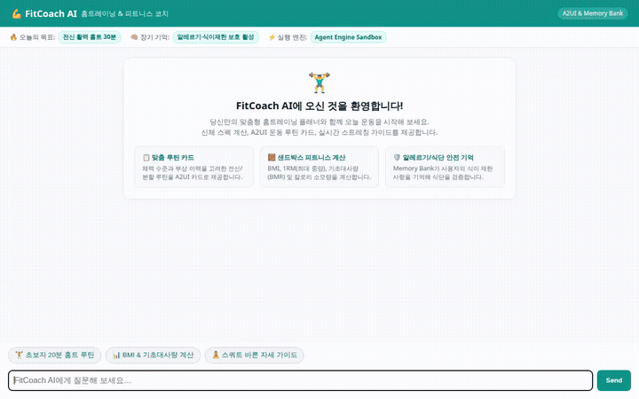

# 💪 FitCoach AI - 맞춤형 홈트레이닝 & 피트니스 코치



> **One-liner**: 대화형 AI를 통해 사용자의 체력 목표, 신체 조건 및 식이/알레르기 정보를 학습하고, 개인 맞춤형 홈트레이닝 루틴 제안, 글로벌 운동 DB 조회, 운동 수행 기록, 피트니스 시각 자료(이미지/비디오) 생성을 지원하는 스마트 피트니스 에이전트입니다.

---

## 🚀 주요 기능 (실제 구현 완료)

FitCoach AI는 Google Agent Development Kit(ADK), Vertex AI, Google Cloud Storage, Firestore 등 실제 엔터프라이즈 Google 기술 스택을 기반으로 제작되었습니다.

### 1. 🧠 장기 기억 (Vertex AI Memory Bank)
* **대화 세션 간 기억 보존**: 사용자의 운동 목표(다이어트, 근비대), 신체 스펙(키, 몸무게), 부상 이력(허리/무릎 통증), 운동 수준을 장기 메모리에 자동 축적합니다.
* **식이 제한 및 알레르기 관리**: 견과류, 유제품 등 음식 알레르기 및 비건, 락토프리 등의 식단 선호도를 필수 기억 정보로 영구 저장하여 모든 피트니스 권장에 반영합니다.
* **PreloadMemoryTool & 자동 메모리 콜백**: 대화 시작 시 사용자의 이전 프로필을 자동 로드하고 대화 종료 시 새롭게 파악된 특성을 메모리 뱅크에 안전하게 커밋합니다.

### 2. 🗄️ 운동 기록 및 카탈로그 관리 (Cloud Firestore & Local Catalog)
* **운동 기록 로깅 (`log_workout_session`)**: 수행한 운동 종목, 세트 수, 반복 횟수, 체감 난이도를 Firestore NoSQL 컬렉션에 실시간 저장합니다.
* **과거 기록 조회 (`get_workout_history`)**: 누적된 운동 이력을 불러와 지속적인 동기부여와 루틴 조정을 지원합니다.
* **카탈로그 & 루틴 조회 (`list_exercises`, `get_exercise_detail`, `list_routines`)**: 상체/하체/코어/전신 필터링을 지원하는 내장 운동 데이터베이스 및 추천 루틴을 제공합니다.

### 3. 🌐 글로벌 피트니스 데이터베이스 연동 (`search_global_exercises`)
* 오픈소스 글로벌 피트니스 데이터베이스(wger) REST API와 연동하여 수백 가지 이상의 글로벌 운동 종목, 타깃 근육군 및 장비 정보를 검색합니다.

### 4. 🎨 생성형 미디어 & 클라우드 스토리지 (Cloud Storage & Gemini)
* **운동 자세 시각화 (`generate_fitness_image`)**:
  * Gemini 이미지 생성 모델(`gemini-3.1-flash-lite-image`)을 사용하여 맨몸 운동 자세 가이드 및 동기부여 일러스트를 실시간 생성합니다.
  * 생성된 이미지는 ADK 아티팩트로 저장됨과 동시에 공개 Google Cloud Storage 버킷에 즉시 업로드되어 웹 어디서나 접근 가능한 퍼블릭 HTTPS URL로 변환됩니다.
* **운동 시연 동영상 생성 (`generate_fitness_video`)**:
  * Vertex AI Gemini 비디오 생성 모델(`gemini-omni-flash-preview`)을 활용하여 실제 동작 시연 비디오 클립을 생성하고 GCS 공개 버킷에 배포합니다.

### 5. 📍 주변 피트니스 장소 검색 (Google Maps Platform)
* **지오코딩 & 장소 검색 (`geocode_address`, `search_nearby_places`)**: 사용자의 동네나 현재 위치를 기반으로 주변 헬스장, 크로스핏 박스, 필라테스 센터, 야외 운동 공원을 탐색합니다.

### 6. 🧮 과학적 피트니스 지표 계산 (`calculate_fitness_metrics`)
* BMI(체질량지수), BMR(기초대사량) 및 TDEE(활동대사량), 그리고 Brzycki 공식을 활용한 1RM(1회 최대 반복 중량)을 정밀 계산합니다.

### 7. 💻 격리된 코드 실행 샌드박스 (Agent Platform Sandbox)
* 복잡한 칼로리 소모 시뮬레이션이나 운동 진행률 통계 산출을 위해 안전한 클라우드 격리 환경인 `AgentEngineSandboxCodeExecutor`를 탑재했습니다.

### 8. 📱 맞춤형 프론트엔드 & A2UI 렌더링
* **A2UI 네이티브 렌더러**: 모델이 전달하는 구조화된 A2UI 카드 컴포넌트를 브라우저에 네이티브 카드로 렌더링합니다.
* **리브랜딩 테마**: 에메랄드 틸 포인트 컬러, 맞춤형 챗 버블 레이아웃, 클릭 가능한 추천 질문 버튼 3종, 상단 통계 바 및 온보딩 히어로 카드가 탑재된 반응형 인터페이스를 지원합니다.

---

## 📌 기능 로드맵: 계획됨 (미구현)

초기 기획안(`project_brief.md`)에서 제안되었으나 현재 단계에서 구현되지 않은 항목들입니다:

* [ ] **웨어러블 기기 실시간 심박수 동기화 및 타깃 심박 구간 자동 추적**: Apple Watch / Wear OS 연동 API
* [ ] **스마트폰 카메라를 통한 실시간 운동 자세 추정(Pose Estimation)**: 사용자 웹캠을 통한 관절 각도 실시간 피드백
* [ ] **소셜 챌린지 및 커뮤니티 랭킹 시스템**: 사용자 간 운동 완료 공유 및 배지 획득 기능

---

## 🛠️ 기술 스택 및 아키텍처

```
┌────────────────────────────────────────────────────────┐
│             사용자 브라우저 (FitCoach Web UI)           │
└───────────────────────────┬────────────────────────────┘
                            │ REST / A2A Protocol
┌───────────────────────────▼────────────────────────────┐
│         FastAPI Proxy Server (frontend/main.py)         │
└───────────────────────────┬────────────────────────────┘
                            │
┌───────────────────────────▼────────────────────────────┐
│            FitCoach AI Agent (app/agent.py)            │
│  - Gemini 2.5 Flash / Gemini 3.1 Flash                 │
│  - A2UI 0.8 Schema Response Builder                    │
└───────┬──────────────┬──────────────┬───────────┬──────┘
        │              │              │           │
 ┌──────▼──────┐┌──────▼──────┐┌──────▼─────┐┌────▼──────┐
 │Vertex AI    ││Cloud        ││Google Cloud││Google Maps│
 │Memory Bank  ││Firestore    ││Storage     ││Platform   │
 │(장기 기억)  ││(운동 기록)  ││(이미지/영상)││(헬스장)  │
 └─────────────┘└─────────────┘└────────────┘└───────────┘
```

* **Core Agent Framework**: Google Agent Development Kit (ADK) `1.4.0`
* **Agent Runtime / LLM**: Google Gemini 2.5 Flash on Vertex AI
* **User Interface**: HTML5 / CSS3 (Tailwind-inspired glassmorphism) + Vanilla JavaScript
* **Backend Proxy**: FastAPI + Uvicorn (A2A Client integration)
* **Storage & Memory**:
  * Google Cloud Storage (공개 자산 호스팅)
  * Google Cloud Firestore (운동 이력 및 세션)
  * Vertex AI Agent Platform Memory Bank (영구 장기 메모리)

---

## 🏃 로컬 설치 및 실행 방법

### 1. 전제 조건
* Python 3.11 이상
* [uv](https://github.com/astral-sh/uv) 패키지 관리자
* Google Cloud CLI (`gcloud`) 인증 완료
  ```bash
  gcloud auth login
  gcloud auth application-default login
  gcloud config set project <YOUR_PROJECT_ID>
  ```

### 2. 가상환경 구성 및 패키지 설치
```bash
# 저장소 루트로 이동
cd fitcoach-agent

# 에이전트 패키지 설치
uv sync
```

### 3. 환경 변수 설정
프로젝트 루트의 `.env` 파일에 필요한 설정을 구성합니다:
```bash
GOOGLE_GENAI_USE_VERTEXAI=true
GOOGLE_CLOUD_PROJECT=<YOUR_PROJECT_ID>
GOOGLE_CLOUD_LOCATION=us-central1
GOOGLE_MAPS_API_KEY=<YOUR_MAPS_API_KEY>
```

### 4. 로컬 실행

#### 방법 A: ADK 개발자 Playground 실행
```bash
uv run adk web . --port 8000 --reload_agents --memory_service_uri=agentengine://<YOUR_MEMORY_BANK_ID>
```
* 브라우저에서 `http://127.0.0.1:8000/dev-ui/?app=app` 접속

#### 방법 B: 맞춤형 프론트엔드(FastAPI) 실행
```bash
cd frontend
python3 -m venv .venv
source .venv/bin/activate
pip install -r requirements.txt

# 에이전트 런타임 및 프론트엔드 프록시 구동
python3 main.py
```
* 브라우저에서 로컬 프론트엔드 포트(기본 8080)로 접속하여 상호작용합니다.
